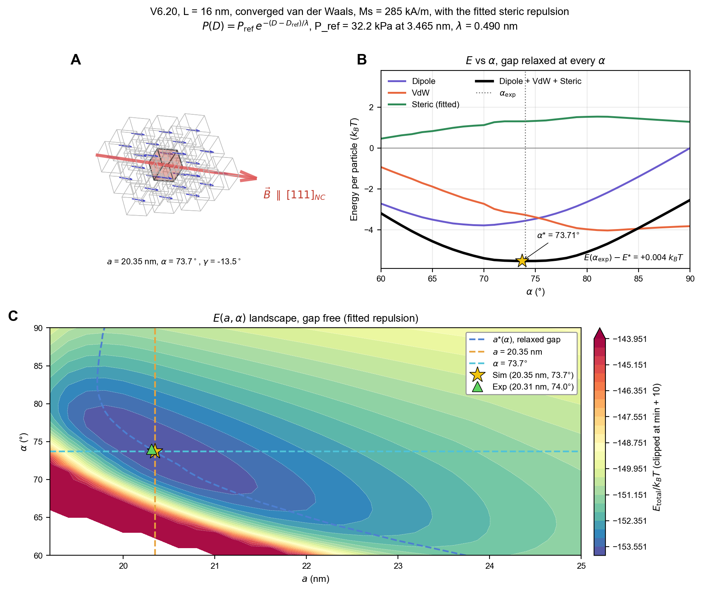

# Rhombohedral Superlattice Energy Calculation (V6.20, converged model)

Energy model for the field-aligned rhombohedral (rh) superlattice of 16 nm
Fe3O4 nanocubes capped with oleic acid, used in Supporting Information
Section S13 of *In Situ SAXS/WAXS Reveals Competing Magnetic and van der Waals
Interactions in Field- and Temperature-Driven Assembly of Fe3O4 Nanocubes*.

The energy of a nanocube at the centre of a 3 x 3 x 3 rh lattice is
minimised over the lattice parameter a, the rh angle alpha and the common
rotation gamma of the cubes about the field. The model reproduces the
measured 16 nm lattice (a = 20.31 nm, alpha = 74.0 degrees), and with no
further adjustment it gives alpha = 72.2-74.0 degrees for 16-29.6 nm cubes,
inside the measured 72-76 degrees.

## What changed from the previous version

The previous version of this repository (tag `v1-fixed-gap-voxel`, commit
`c63273d`) evaluated the van der Waals term with a 4 x 4 x 4 voxel sum and
imposed a fixed nearest surface gap of 3.38 nm. Two things were wrong with
that combination.

1. **The voxel sum was not converged.** It converges at second order in the
   voxel number N. At N = 4 it gives only 61 % of the exact attraction at the
   reference state (-2.08 against -3.43 kBT per particle), and 1 % accuracy
   needs N of about 36. The model now uses the exact continuum limit of the
   same integral.
2. **With the converged attraction, the old agreement disappears.** At the
   fixed gap, the minimum moves from alpha = 74.2 to 78.6 degrees. The
   earlier agreement with experiment rested on the under-converged
   attraction, and the two candidate angles were separated by only 0.09 kBT
   against a quadrature error of 1.35 kBT.

The gap is therefore no longer imposed. A soft steric repulsion of the
oleic acid shells sets it, and the repulsion's two parameters are fitted to
the measured 16 nm lattice with the measured magnetisation.

## Model

Energy per particle, in kBT at T = 298.15 K:

```
E = E_Z + E_ani + E_dd(26) + E_vdW(6) + E_st
```

| Term | Treatment |
|---|---|
| Geometry | rh lattice a1 = a(c, s, 0), a2 = a(c, -s/2, sqrt(3)s/2), a3 = a(c, -s/2, -sqrt(3)s/2), c = [(1 + 2 cos alpha)/3]^(1/2); rounded cubes, edge L = 16 nm, corner radius 1.5 nm; one common orientation, rotated by gamma about the field |
| E_Z, E_ani | Zeeman and cubic anisotropy with Ms = 2.85 x 10^5 A/m (measured), B = 0.50 T, K = 2.0 x 10^4 J/m^3. The moment lies along the field and a cube <111> axis, so both terms are constant: -141.79 and -6.63 kBT |
| E_dd(26) | point dipoles mu = Ms L^3, summed over the 26 neighbours of the 3 x 3 x 3 shell, halved |
| E_vdW(6) | exact continuum Hamaker energy of two co-oriented sharp cubes, A = 2.0 x 10^-20 J, summed over the six primitive bonds (the six-fold integral is reduced to a one-dimensional quadrature, see `cube_pair_hamaker_J`) |
| E_st | soft exponential steric pressure P(D) = P_ref exp[-(D - D_ref)/lambda], areal energy w(D) = P_ref lambda {exp[-(D - D_ref)/lambda] - e^-8} for D < D_ref + 8 lambda. It is integrated over the rounded-cube surfaces along the closest-approach normal (Derjaguin / surface-element integration) for all 13 inequivalent neighbour pairs |

Fitted steric parameters (16 nm, Ms = 285 kA/m):

| Parameter | Value |
|---|---|
| decay length lambda | **0.490 nm** |
| P_ref at D_ref = 3.465 nm | **32.2 kPa** |

The exponential is the standard form of the repulsion between two
compressed brushes at intermediate compression, with decay length L0/pi for
a brush of thickness L0 (Israelachvili). The fitted lambda corresponds to
L0 = 1.54 nm, comparable to the oleic acid layer measured on magnetite
(1.4 nm on (111) facets; Creutzburg et al. 2022). The pressure at the
equilibrium gap, about 50 kPa, balances a flat-plate van der Waals pressure
of A/(6 pi D^3) = 31 kPa plus the dipolar attraction.

An Alexander-de Gennes brush was tested as well and cannot do this. Its
repulsion switches on only when the brushes touch, so at force balance it
carries less than 0.1 kBT per particle and leaves alpha* near 78.4 degrees.

The two parameters were fitted by requiring that the vertex of a parabola
through the valley floor, min over a of E(a, alpha) at
alpha = 74 +/- {0, 0.4, 0.8, 1.2} degrees, lies at the measured (a, alpha).
The iteration uses Broyden updates in (log P_ref, lambda). A
derivative-based fit is not reliable here, because E_min(a, alpha) is only
piecewise smooth and a vanishing central difference can sit on a slope
break.

## Results

### 16 nm

| Solver | alpha* (deg) | a* (nm) | E_int (kBT) |
|---|---|---|---|
| valley vertex (the fit condition) | 74.04 | 20.298 | -5.528 |
| free-gap scan, (alpha, D) coordinates | 73.69 | 20.349 | -5.532 |
| fine valley scan, fixed-a solver, 0.2 deg steps | 73.69 | 20.347 | - |
| free (a, alpha) landscape, 31 x 30 grid refined | 73.71 | 20.347 | -5.532 |
| **experiment** (SI Table S1) | **74.0** | **20.31** | |

At the minimum:

- nearest surface gap 3.28 nm, gamma* = -13.5 degrees;
- E_dd = -3.59, E_vdW = -3.26 and E_st = +1.32 kBT, so E_int = -5.53 kBT and E = -153.96 kBT per particle.

The valley floor is flat along alpha, varying by less than 0.01 kBT between
73.4 and 74.6 degrees. That flatness is why the solvers differ by 0.3
degrees.

### Other sizes, parameters frozen at their 16 nm values

| L (nm) | alpha* (deg) | a* (nm) | gap (nm) | measured |
|---|---|---|---|---|
| 13 | 74.6 | 17.02 | 3.49 | sc; the moments are not blocked at room temperature, which the model assumes they are |
| 18 | 72.8 | 22.58 | 3.27 | alpha = 72-76 deg for 16-30 nm (SI S14) |
| 18.2 | 72.8 | 22.79 | 3.26 | as above |
| 19.5 | 73.3-73.5 | 24.07-24.09 | 3.21-3.27 | as above |
| 29.6 | 72.2 | 35.03-35.05 | 3.52-3.54 | as above |

An fcc-like lattice (alpha = 60 degrees) costs 4.3 kBT per particle at
19.5 nm and 14.8 kBT at 29.6 nm relative to the minimum. The calibrated
Alexander-de Gennes brush gives alpha* = 78.4 degrees at 16 nm and
79.5 degrees at 18 nm.

The table `EXP_DATA` in `v620_brush_vdw.py`, ported from the original
notebook, lists alpha = 60 degrees for the 19.5 and 29.6 nm samples. The
manuscript (SI S14) reports 72-76 degrees for 16-30 nm, so the figures
compare those sizes with the measured range instead.

## Figures

| File | Content |
|---|---|
| `outputs/.../brush_vdw/R_fitted_repulsion_figure_JACS_B`, `_JACS_C` (.pdf, 600 dpi .tif, .png) | main-text Figure 4B and 4C as printed: (B) energy components against alpha with a and gamma relaxed, (C) total energy against a and alpha, gamma relaxed, with the relaxed a at each alpha (dashed) |
| `outputs/.../brush_vdw/R_SI_S16_final` (.pdf, .tif, .png) | SI Figure S16: (A) dipolar, vdW, steric and total energies against the nearest surface separation D at alpha = 74.0 degrees; (B) vdW energy against alpha with a and gamma relaxed (as in Figure 4B) and at D = 3.3 nm with gamma = 0 (`S16_vdw_fixed_gap.csv`) |
| `outputs/.../brush_vdw/R_fitted_repulsion_figure_manuscript*`, `_JACS*` | the same Figure 4 as one figure and as separate panels A, B, C |
| `outputs/.../brush_vdw/R_fitted_repulsion_figure.png` | three-panel diagnostic figure for 16 nm, same layout as main-text Figure 4: (A) lattice, (B) energy components against alpha with a, gamma and the gap relaxed, (C) free E(a, alpha) landscape |
| `outputs/.../brush_vdw/R_fitted_repulsion_figure_L{18,18.2,19.5,29.6}.png` | the same for the other sizes, parameters frozen |
| `outputs/.../brush_vdw/R_repulsion_fit_summary.png` | model summary: fitted law against the AdG brush, which laws can move the angle, voxel against exact vdW, E_min(alpha) before and after, the valley floor, size transfer |



## Reproduce

```bash
python -m pip install -r requirements.txt
cd code/V6.20_energy_landscape_EaAlpha
python -m unittest test_v620_brush_vdw -v        # 36 tests, ~20 s

python run_vdw_convergence.py            # A  voxel ladder vs exact vdW        ~9 min
python run_brush_refit.py                # B  AdG brush, free gap              ~50 min
python run_neighbour_convention.py       # C  neighbour convention, dipole cut ~15 min
python run_hamaker_sensitivity.py        # D  Hamaker constant scan            ~2 min
python run_magnetic_parameter_audit.py   # E  magnetic parameters vs literature ~1 min
python run_figure_reproduction.py        # F  fixed-gap three-panel figures    ~10 min
python run_repulsion_family_probe.py     # R0 which repulsion laws can work    ~20 min
python run_repulsion_fit.py --transfer   # R1-R4 fit, verification, transfer  ~80 min
python run_repulsion_transfer_check.py   # R5 cost of the measured angle       ~15 min
python run_repulsion_figure.py           # 16 nm three-panel figure            ~50 min
python run_repulsion_figure.py --size 18 # likewise 18.2, 19.5, 29.6           ~40 min each
python run_repulsion_summary_figure.py   # model summary figure                seconds
python run_repulsion_figure.py --replot --jacs --panels   # Figure 4 panels   seconds
python run_si_s16_figure.py              # SI Figure S16                       ~1 min
```

Timings were measured on a shared, fully loaded workstation. Every script
writes to `outputs/V6.20_energy_landscape_EaAlpha/brush_vdw/`.
`run_repulsion_figure.py --replot` redraws a figure from the saved data
without recomputing it.

## Files

`code/V6.20_energy_landscape_EaAlpha/`

| File | Content |
|---|---|
| `v620_brush_vdw.py` | model module: the V6.20 Hamiltonian, the exact vdW limit, the voxel ladder, the AdG and exponential steric laws on Derjaguin areas, gap relaxation |
| `v620_brush_fitting.py` | fixed-gap and free-gap alpha scans, twist relaxation, brush-height calibration |
| `v620_repulsion_fit.py` | the fitted repulsion: fixed-a twist relaxation and the valley-vertex fit |
| `run_*.py` | the calculations listed above |
| `test_v620_brush_vdw.py` | unit tests, including the exact reproduction of the original notebook |
| `V6.20rhombo_EaAlpha.ipynb` | the original fixed-gap, 4 x 4 x 4 voxel calculation, kept for reference |

`outputs/V6.20_energy_landscape_EaAlpha/brush_vdw/` holds every CSV, JSON
report and figure written by the scripts, prefixed by series (A-F, R0-R5).
`FINDINGS_ZH.md` in the same directory is the full analysis, in Chinese.

## Reproducing the original calculation

`BrushPhys(brush_model="off", voxel_count=4)` reproduces the original
notebook exactly. The tests pin it to the archived notebook output: gap
3.377736 nm, E_dd = -3.5563 kBT and E_vdW = -2.0838 kBT at the reference
state.

## Limitations

- The dipolar term uses point dipoles and a 26-neighbour sum. Extending the
  sum changes the reference-state dipolar energy by 0.11 kBT, although the
  change largely cancels between competing angles.
- The vdW term keeps the six primitive bonds and treats the cores as sharp
  cubes, while the gap and the steric term use rounded cubes. Where sharp
  cubes would overlap the vdW integral diverges, so the twist search
  excludes any configuration with a rounded-cube or sharp-cube gap below
  1 nm. No reported state comes near that floor: all have gaps above 3 nm.
- The steric parameters are fitted: two parameters for two observables at
  16 nm. They absorb the errors of the approximations above and are
  effective parameters of this model, not a measurement of the ligand shell.
  The size transfer is the test of the model.
- The result is a zero-temperature energy of a rigid, defect-free lattice.
  Entropy, solvent structure, many-body dispersion and non-uniform
  magnetisation are not included.

## Requirements

Python 3.10 or later with NumPy, SciPy and Matplotlib. JupyterLab is needed
only for the original notebook.

## References

1. Faure, B.; Salazar-Alvarez, G.; Bergström, L. Hamaker Constants of Iron Oxide Nanoparticles. *Langmuir* **2011**, *27*, 8659-8664. https://doi.org/10.1021/la201387d
2. Hamaker, H. C. The London-van der Waals Attraction between Spherical Particles. *Physica* **1937**, *4*, 1058-1072. https://doi.org/10.1016/S0031-8914(37)80203-7
3. de Gennes, P. G. Polymers at an Interface; a Simplified View. *Adv. Colloid Interface Sci.* **1987**, *27*, 189-209. https://doi.org/10.1016/0001-8686(87)85003-0
4. Israelachvili, J. N. *Intermolecular and Surface Forces*, 3rd ed.; Academic Press, 2011; Chapter 16.
5. Creutzburg, M.; Konuk, M.; Tober, S.; Chung, S.; Arndt, B.; Noei, H.; Meißner, R. H.; Stierle, A. Adsorption of Oleic Acid on Magnetite Facets. *Commun. Chem.* **2022**, *5*. https://doi.org/10.1038/s42004-022-00741-0

## Citation

If this code is used in a publication, cite the associated article and this
repository. Publication details can be added after acceptance.
